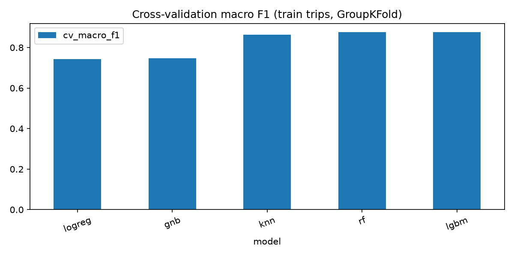
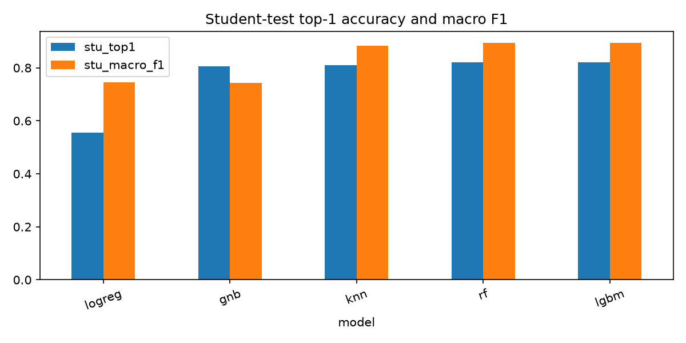
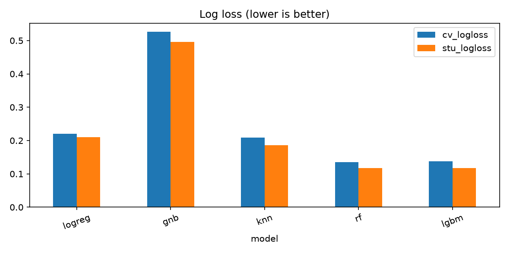

# 3. Models and training

## 3.1 Experimental setup and comparison

The task is binary candidate classification: each candidate arc row is labelled
1 when its `arc_id` matches the reference arc for that observation, and 0
otherwise. The six model inputs were `f_dist`, `f_rank`, `f_dist_gap`,
`f_proj`, `f_bearing_diff`, and `f_speed`; `arc_id` was not used as a feature.
We used seed 42 and three-fold `GroupKFold` with `trip_id` as the group, so
observations from a trip never appear in both a training and validation fold.
Models were trained on the 80 training trips and compared on the 10
student-test trips.

The label join retained only observations with an aligned, non-null label and
at least one candidate matching the true arc. Training retained 1,384,112
candidate rows; student-test retained 149,623. In student-test, 17 of 19,160
labels were unaligned and 29 of the remaining 19,143 observations were
candidate misses. Thus the reported student top-1 score uses 19,114
observations. It is conditional on the true arc being present in the
candidate set; it is not full-coverage or HMM-decoded accuracy.

Macro-F1 and log loss are calculated over candidate rows. Top-1 is
observation-level accuracy: for each `(trip_id, obs_idx)`, select the
highest-scoring candidate and check whether it is the true arc. Train time is
the final full-data refit time, not the time for all CV folds. Inference time
is for the student candidate table.

| Model | Initial configuration | CV macro-F1 | CV log loss | CV top-1 | Student top-1 | Student macro-F1 | Student log loss | Train macro-F1 | Final fit (s) | Student inference (s) |
|---|---|---:|---:|---:|---:|---:|---:|---:|---:|---:|
| Logistic Regression | StandardScaler, C=1, max_iter=500 | 0.7429 | 0.2199 | 0.5576 | 55.55% | 0.7445 | 0.2105 | 0.7435 | 4.95 | 0.055 |
| Gaussian Naive Bayes | StandardScaler, var_smoothing=1e-9 | 0.7461 | 0.5261 | 0.7791 | 80.66% | 0.7429 | 0.4955 | 0.7460 | 0.35 | 0.044 |
| KNN | StandardScaler, k=15, distance weights; max 150,000 fit rows | 0.8643 | 0.2093 | 0.7858 | 81.02% | 0.8830 | 0.1857 | 1.0000 | 0.34 | 4.984 |
| Random Forest | 100 trees, max_depth=12, min_samples_leaf=5 | 0.8753 | 0.1349 | 0.7985 | 81.98% | 0.8931 | 0.1172 | 0.8812 | 71.54 | 0.295 |
| LightGBM | 300 trees, learning_rate=0.05, num_leaves=31 | 0.8756 | 0.1376 | 0.7987 | 82.18% | 0.8936 | 0.1173 | 0.8806 | 7.69 | 0.370 |

These are classifier-only results. Route continuity was not included in the
baseline table; add it after C's real-data HMM/continuity comparison is
available.

### Logistic Regression

The distance, rank, projection, bearing, and speed features provide a useful
linear baseline after scaling. It is fast and provides a simple reference,
but its CV macro-F1 (0.7429) and student top-1 (55.55%) are well below the
tree-based models, suggesting that a linear decision boundary does not capture
the feature interactions well. Train, CV, and student macro-F1 are close
(0.7435, 0.7429, and 0.7445), so the weak result is more consistent with
underfitting than overfitting.

### Gaussian Naive Bayes

GaussianNB is a fast probabilistic baseline for the continuous candidate
features. Its independence assumption is unlikely to hold for related
quantities such as distance and distance gap. Student top-1 is 80.66%, but
candidate-row log loss is poor (0.4955 student; 0.5261 CV), indicating weak
probability estimates. Train, CV, and student macro-F1 are similar
(0.7460, 0.7461, and 0.7429).

### K-Nearest Neighbors

KNN can model local, nonlinear neighborhoods in the geometric features, so it
was scaled and fit on at most 150,000 rows for speed. It reached 0.8830
student macro-F1 and 81.02% student top-1, but its train macro-F1 was 1.0000
against 0.8643 CV macro-F1, a 0.1357 train-to-CV gap consistent with
overfitting. Student inference took 4.98 seconds for 149,623 candidate rows,
substantially slower than the other models.

### Random Forest

The capped-depth forest can capture nonlinear interactions among the
candidate features. It was the strongest untuned model on CV log loss
(0.1349) and achieved 81.98% student top-1. Train, CV, and student
macro-F1 were 0.8812, 0.8753, and 0.8931; the 0.0059 train-to-CV gap is
modest. The main cost was final fitting time (71.54 seconds); student
inference took 0.295 seconds.

### LightGBM

Boosted trees can learn nonlinear interactions while fitting the large
candidate table efficiently. The untuned model achieved the best student
top-1 among the five baselines (82.18%) and the highest CV macro-F1 (0.8756).
Train, CV, and student macro-F1 were 0.8806, 0.8756, and 0.8936, with a
0.0051 train-to-CV gap. It trained in 7.69 seconds and inferred on the student
table in 0.370 seconds. The tuned result is reported in Section 4.

## 3.2 Selection and limitations

The untuned Random Forest had the lowest CV log loss, while untuned LightGBM
had the highest student top-1. After tuning, LightGBM had both the lowest CV
log loss and the highest student top-1 among these results; it is the current
classifier choice. CV log loss was used as the tuning objective because the
HMM consumes classifier probabilities. Since the evaluator has stated that
accuracy is the scored metric, pointwise top-1 is also reported prominently.
The tuned-vs-baseline student top-1 gain is small (0.089 percentage points),
so it should not be presented as a large accuracy improvement.

The pointwise top-1 values above are classifier-only and exclude observations
with missing labels or candidate misses. The final score must use the
evaluator's denominator and, if required, the HMM-decoded predictions. The
classifier-vs-HMM pointwise accuracy and route-continuity comparison remains
pending C's integration.

The comparison plots are:

